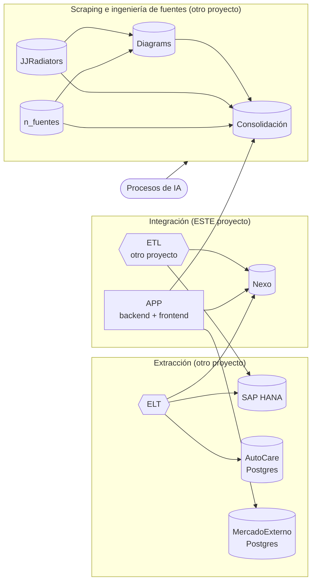

# Arquitectura general

Imagen original: [arquitectura-general.jpg](arquitectura-general.jpg)

Lectura del diagrama:
- **Negro**: el ELT de extracción alimenta Nexo desde SAP y conecta con AutoCare.
- **Morado**: el ETL de integración regresa datos a SAP.
- **Naranja**: el ETL escribe en Nexo; la APP lee/escribe Nexo, agrega vehículos fuera de AutoCare en MercadoExterno (ADR 0014) y consulta Consolidación.
- **Verde / rojo**: el scraping alimenta Diagrams y Consolidación.
- **Azul**: los procesos de IA operan sobre toda la capa de ingeniería de fuentes.

Este proyecto implementa solo **Nexo** y la **APP**. Los ETL/ELT aparecen como contratos.
