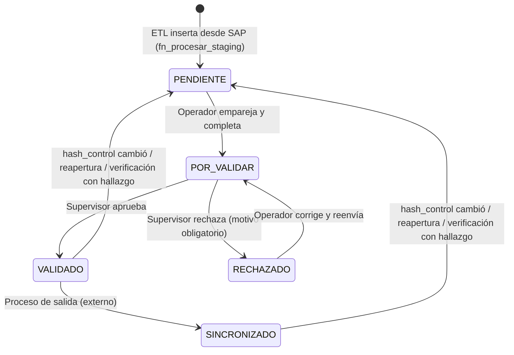

# Workflow del artículo

Flujo con **doble control** (ADR 0012): el operador empareja y completa, y un supervisor valida.

## Estados
| Estado | Quién lo asigna | Significado | Bandeja |
|---|---|---|---|
| `PENDIENTE` | ETL (alta), regla de checksum, administrador o supervisor (reapertura) | Por trabajar: sin emparejar, o reabierto conservando lo hecho | Operador |
| `POR_VALIDAR` | Operador | Emparejado y completo; espera revisión | Supervisor |
| `RECHAZADO` | Supervisor | El supervisor encontró errores; vuelve al operador con motivo | Operador |
| `VALIDADO` | Supervisor | Aplicaciones, tipo de parte, atributos, equivalencias e imágenes confirmados | — |
| `SINCRONIZADO` | Proceso de salida (externo) | Actualizado en SAP con los datos validados | — |

## Reglas
1. **Toda transición se registra** en la bitácora: estado origen, destino, actor (usuario o proceso), fecha y motivo.
2. **Motivo obligatorio** en `RECHAZADO` y en toda vuelta a `PENDIENTE` (`HASH_CAMBIO`, `REAPERTURA`, `VERIFICACION`).
3. **Doble control**: quien valida (`POR_VALIDAR → VALIDADO`) no puede ser el mismo usuario que envió el artículo a `POR_VALIDAR`.
4. **Para enviar a `POR_VALIDAR`** el artículo debe tener: tipo de parte (PCdb), al menos una aplicación vehicular **o** un emparejamiento
   con el catálogo maestro, y los atributos del tipo de parte marcados `habilitado` y `obligatorio` en `meta.atributo_config` (ADR 0019), todo **confirmado** por el
   operador. La equivalencia **no** es requisito: el código equivalente de los fabricados se captura en la revisión de fabricados y
   se valida con foto propia, sin afectar el estado (ADR 0018).
   Al confirmar la equivalencia, el Fabricado hereda la parte emparejada y recibe las aplicaciones del Importado como sugerencias.
5. **Regla de checksum**: si `fn_procesar_staging` detecta otro `hash_control` en un artículo `VALIDADO` o `SINCRONIZADO`, lo regresa
   a `PENDIENTE` (actor `PROCESO:ETL`, motivo `HASH_CAMBIO`) **conservando** el emparejamiento y los datos ya confirmados, y mostrando
   al operador qué campos de SAP cambiaron. En `PENDIENTE`, `POR_VALIDAR` o `RECHAZADO` solo se actualizan los datos y el hash.
6. **Reapertura**: el administrador o el supervisor pueden regresar un `VALIDADO` o `SINCRONIZADO` a `PENDIENTE` con motivo.
7. **Verificación** (mantenimiento): ver abajo. No cambia el estado salvo que encuentre un problema.
8. **Concurrencia**: un artículo solo puede editarlo un usuario a la vez. El usuario toma el siguiente artículo de su bandeja con
   **"Siguiente"** (respetando el filtro global); queda **reservado 30 minutos** y la reserva se renueva sola mientras trabaja en él.
   Al vencer, vuelve a la bandeja. Además, cada fila lleva `version` (control optimista). El administrador puede liberar o reasignar.
9. **Inactivos** (ADR 0008): la bandera `activo` es independiente del estado. Un artículo inactivo conserva su estado, pero no aparece
   en la APP, no se asigna ni cambia de estado y no se publica.

## Verificación (mantenimiento)
Revisión periódica de artículos ya validados, en una **cola de tareas** aparte del workflow (`tarea_verificacion`).

| Origen de la tarea | Cuándo |
|---|---|
| `NUEVA_FOTO` | Aparece una foto propia nueva del artículo en MinIO (`imagenes_inventario/`) |
| `MUESTREO` | Muestra aleatoria periódica de artículos `VALIDADO`/`SINCRONIZADO` (control de calidad) |
| `CAMBIO_CATALOGO` | Cambió la `parte` emparejada en Consolidación (fusionada, descartada o con datos nuevos) |
| `MANUAL` | Un supervisor o administrador la crea |

Resultados posibles:
- **Conforme**: se cierra la tarea; si era `NUEVA_FOTO`, la foto queda validada y el artículo no cambia de estado.
- **Con hallazgo**: el artículo vuelve a `PENDIENTE` (motivo `VERIFICACION`) con la nota del hallazgo.
