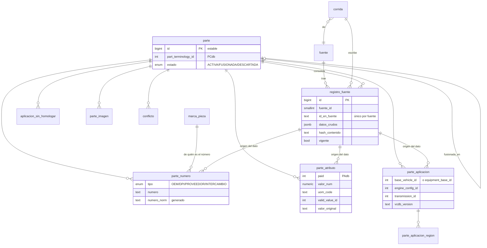

# Consolidación — contrato para el proceso de carga

`articulos_consolidacion` es el **catálogo maestro** de piezas del mercado: `db_diagrams` + todos los proveedores scrapeados,
estandarizado con AutoCare (ADR 0009, 0011). **Este esquema gobierna**: el proceso de carga se adapta a él, no al revés.

| Archivo | Qué es |
|---|---|
| [migraciones/](migraciones/) | DDL versionado. La fuente de verdad del esquema |
| [ejemplos/ejemplo_carga.sql](ejemplos/ejemplo_carga.sql) | Tres diagramas reales de `db_diagrams` cargados según el contrato |
| [ejemplos/ejemplo_carga.md](ejemplos/ejemplo_carga.md) | El mismo ejemplo explicado paso a paso |
| [../pruebas/probar.py](../pruebas/probar.py) | Pruebas: lo que el contrato acepta y lo que rechaza |

## Diagrama



Esquemas: `catalogo` (datos), `carga` (corridas), `ref` (copia de referencia de AutoCare, solo lectura para el proceso).

## Reglas del contrato

Las marcadas con 🔒 las hace cumplir la base: si el proceso las viola, la escritura falla con un error `CONTRATO: …`.

1. **Corridas de foto completa** (ADR 0026). Cada carga de una fuente abre un `carga.corrida` con `completa = true` y trae
   **todo** lo de esa fuente. La cierra `select carga.fn_cerrar_corrida(corrida_id)`, que marca `vigente = false` lo que no vino,
   abre conflictos de medidas y la deja `COMPLETA`; devuelve `{no_vigentes, conflictos}`. 🔒 Si quedaría no vigente más del 5 %
   de lo vigente (y más de 10), falla con `CORRIDA_INCOMPLETA` y no aplica nada: el proceso marca la corrida `FALLIDA`, alerta y
   no reintenta a ciegas. 🔒 No se escribe un `registro_fuente` en una corrida cerrada.
2. **Un registro por pieza y fuente.** `registro_fuente` se escribe con *upsert* por (`fuente_id`, `id_en_fuente`). 🔒 Único.
   **Siempre** se actualiza `corrida_id` (así la corrida sabe que lo vio) y `vigente = true`; si `hash_contenido` (sha256 de
   `datos_crudos`) no cambió, no se toca nada más y se cuenta en `sin_cambios` (no cambia `actualizado_en`).
3. **Nada se pierde.** `datos_crudos` guarda **todo** lo que vino, sin transformar.
4. **Nunca DELETE.** 🔒 Lo que ya no publica la fuente queda `vigente = false`. Si dos partes son la misma, una pasa a
   `FUSIONADA` con `fusionada_en_id` (🔒 obligatorio); una parte errónea pasa a `DESCARTADA`. Los IDs de `parte` son estables
   porque Nexo los referencia.
5. **Trazabilidad.** Cada número, atributo, aplicación e imagen lleva el `registro_fuente_id` del que salió.
6. **Tipo de parte.** 🔒 `part_terminology_id` debe existir en PCdb (2172 Radiator, 6708 A/C Condenser, 12616 Intercooler…;
   ver `context/categorias.md`).
7. **Números.** `numero` tal como viene; `numero_norm` lo calcula la base (mayúsculas, solo `A-Z0-9`).
   🔒 OEM, PROVEEDOR e INTERCAMBIO requieren `marca_pieza_id`; DPI no. Si un campo trae varios números (`2531022050/22070`),
   se separan en filas y se expanden las abreviaturas, con menor `confianza`. **OEM verificados** (ADR 0026): confirmados con
   `confianza` 1,0; pendientes o sin verificación, 0,5; los inconclusos (dato roto) y descartados no se publican (quedan en
   `datos_crudos`).
8. **Atributos PAdb.** 🔒 El `paid` debe estar asignado a ese tipo de parte. 🔒 Exactamente uno de `valor_num`,
   `valid_value_id` o `valor_texto`. 🔒 Si PAdb asigna unidades al atributo, `valor_num` lleva `uom_code`.
   Longitudes **en mm**. `valor_original` guarda el texto de origen (`335x608x16/22/26`).
   Medidas del panal: 267 Core Height, 269 Core Width (largo), 268 Core Thickness (ancho). Con espesor doble o triple
   (`16/26`), 268 = el **primer** número; no se adivina qué son los demás.
9. **Aplicaciones ACES.** 🔒 Exactamente uno de `base_vehicle_id` o `equipment_base_id`, y deben existir en AutoCare,
   o ser IDs ≥ 1 000 000 000 de MercadoExterno. Las regiones son opcionales (`parte_aplicacion_region`).
   Los calificadores que no se resuelvan a ID (motor en texto) van en `notas`.
10. **Lo obsoleto de AutoCare** (ADR 0024). Lo que AutoCare quitó queda en `ref` con `obsoleto_en`. 🔒 No se asigna en filas
    nuevas ni al cambiar el valor (tipo de parte, atributo, valor permitido, vehículo); lo que ya lo usaba se conserva y se puede
    editar. Usar solo lo vigente: `obsoleto_en is null`.
11. **Lo que no se puede estandarizar no se inventa.** Solo se homologa lo que se identifica sin ambigüedad (marca, modelo y años;
    submodelo y motor si están claros). Un vehículo que no se pudo llevar a `base_vehicle_id` (texto ambiguo, en chino, solo la
    marca, o que no existe en AutoCare) va a `aplicacion_sin_homologar` con el texto y su `motivo`; los que faltan en AutoCare los
    registra después el proceso de IA de vehículos (MercadoExterno), que toma esa lista. Un dato contradictorio va a `conflicto`.
12. **Imágenes.** Las de los proveedores se **copian a MinIO** (`rlt-diagramas`, prefijo por fuente: `jjradiator/…`) y se guardan
    `minio_bucket`/`minio_objeto` **y** la `url` original; los diagramas ya están en `rlt-diagramas`.
13. **Misma pieza en varias fuentes** (ADR 0026). Los registros que son la misma pieza apuntan a la misma `parte`
    (`vinculo_metodo`, `vinculo_confianza`). Diagramas ↔ JJ: según `db_diagrams.jjradiator_cross_reference`; los `confirmado` con
    confianza 1,0 y los `revisar_manual` también se unen, con confianza 0,5 y, si el OEM no coincide, un conflicto
    `NUMERO_DUPLICADO` con los dos OEM. Lo que no tiene cruce es una parte propia.
14. **Prioridad de fuentes.** `catalogo.fuente.prioridad` (1 = más confiable): `DB_DIAGRAMS` 1, `JJ_RADIATOR` 2. La búsqueda
    toma cada medida de la fuente de mayor prioridad que siga vigente; se guardan todas. 🔒 Si las medidas del panal de una parte
    difieren más de 2 mm entre fuentes, `fn_cerrar_corrida` abre un conflicto `ATRIBUTO_DISCREPA`.

## Cómo empezar (ambiente local)

```bash
uv run db/aplicar.py consolidacion --dsn "host=postgres dbname=mi_prueba user=postgres password=postgres"
uv run db/ref/cargar_ref.py consolidacion --destino "host=postgres dbname=mi_prueba user=postgres password=postgres"
psql "host=postgres dbname=mi_prueba user=postgres" -f db/consolidacion/ejemplos/ejemplo_carga.sql
```

## Pendiente de acordar
- Cómo se unen las piezas de fuentes nuevas (NRF, CSF, TYC…) que no tengan una tabla de cruces como la de diagramas ↔ JJ.
- Lista inicial de `marca_pieza` (con `brand_aaiaid` de PIES cuando exista). Las fuentes iniciales ya vienen en la migración V004.
