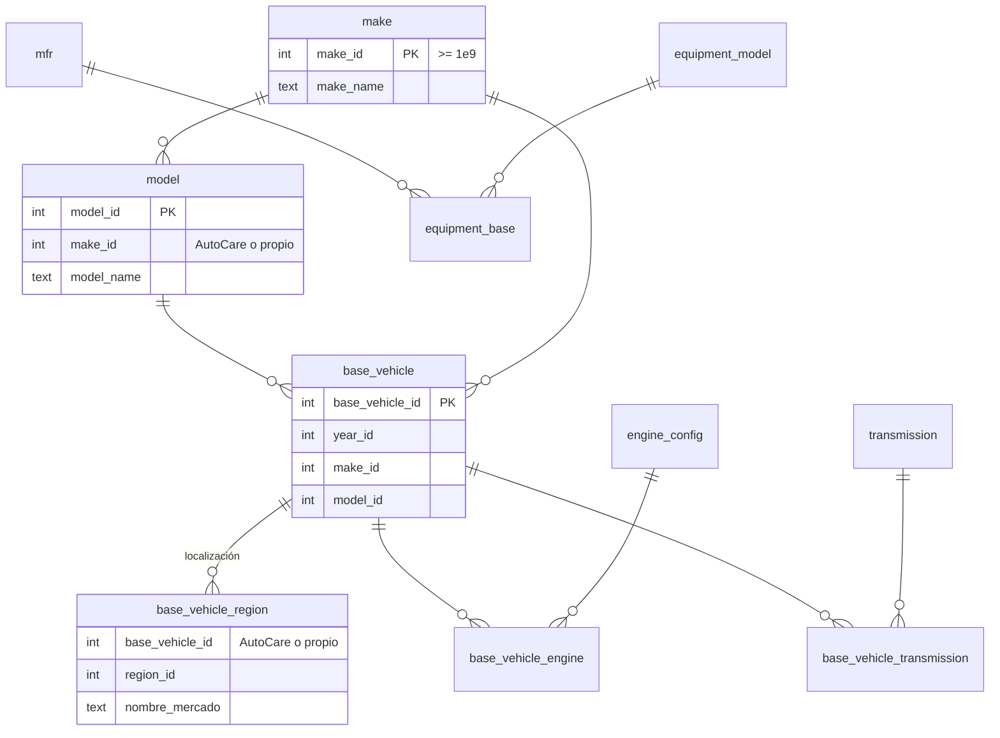

# MercadoExterno — contrato para la IA con búsqueda web y la APP

`mercado_externo` guarda los **vehículos, marcas y equipos del mercado que no están en AutoCare**, con la misma estructura
y nombres de VCdb (ADR 0014). Ejemplos: modelos de Changan vendidos en Guatemala que VCdb no tiene, Great Wall, plantas Generac.

## Regla principal
**Nadie inserta directo.** Se usan dos funciones, que primero buscan en AutoCare y en MercadoExterno, y solo insertan lo que falta:

```sql
-- Vehículo: un base_vehicle_id por año del rango
select * from vcdb.fn_registrar_vehiculo(
  p_marca => 'Changan', p_modelo => 'CS35 Plus', p_anio_desde => 2021, p_anio_hasta => 2023,
  p_origen => 'IA_WEB', p_creado_por => 'ia-busqueda-web',
  p_evidencia => '["https://www.changan.com.gt/cs35-plus"]', p_confianza => 0.8,
  p_regiones => '{GTM}', p_nombre_mercado => 'CS35 Plus');
--  anio | base_vehicle_id | catalogo        | nuevo
--  2021 | 1000000001      | MERCADO_EXTERNO | t

-- Equipo (plantas, montacargas, maquinaria)
select * from vcdb.fn_registrar_equipo('Generac', 'SD150', 'IA_WEB', 'ia-busqueda-web', '["https://..."]', 0.8);
```

- Si el vehículo ya está en AutoCare, devuelve **su** ID con `catalogo = 'AUTOCARE'` y no inserta nada.
- Si ya existe aquí (aunque se escriba distinto: `cs-35 plus`), devuelve el mismo ID con `nuevo = false`.
- Si la marca existe en AutoCare (Changan), la reutiliza y solo crea el modelo o los años que faltan.
- Es segura ante llamadas simultáneas: índices únicos y `on conflict`.

## Diagrama



Toda tabla propia guarda `origen` (`IA_WEB`/`APP`), `creado_por`, `evidencia` (lista JSON de URLs o fichas), `confianza`
y `estado` (`ACTIVO`, `REEMPLAZADO` con `reemplazado_por_id` cuando AutoCare lo incluya, `DESCARTADO`).

## Lo que la base rechaza
- Registrar sin evidencia, con rango de años inválido o con una región que no existe en VCdb.
- Insertar directo una marca, modelo, base vehicle, fabricante o equipo que ya existe en AutoCare.
- `DELETE` de cualquier tabla.

## Vista para buscadores
`vcdb.v_base_vehicle` une AutoCare + MercadoExterno: `base_vehicle_id`, año, marca, modelo y `origen_catalogo`.
